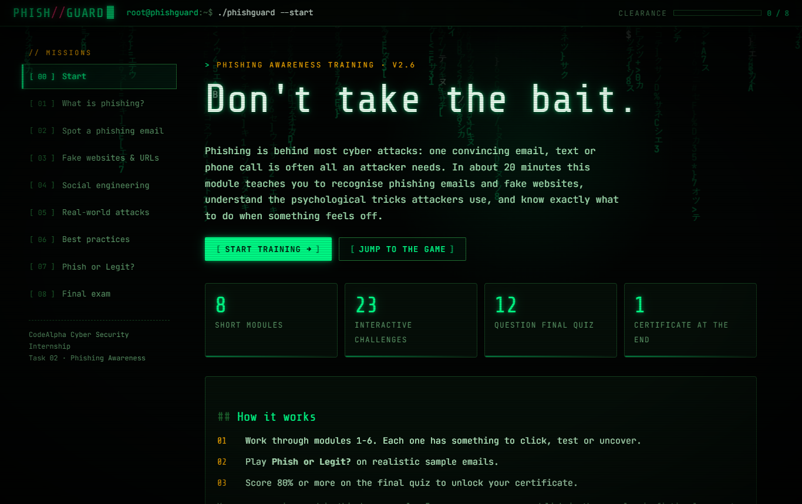
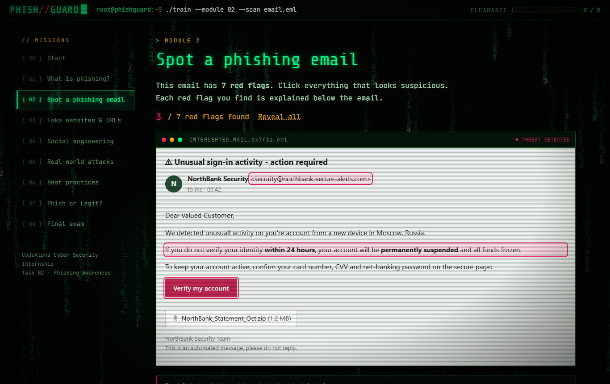
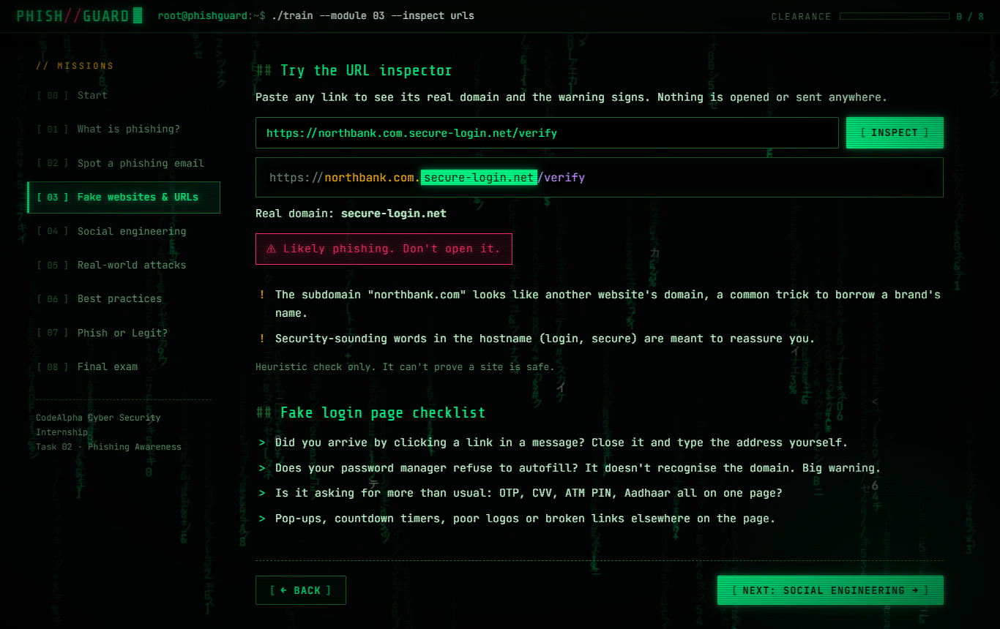
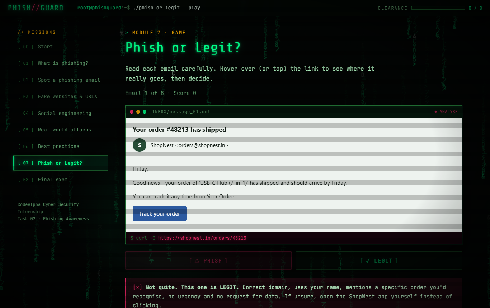

# PhishGuard: Phishing Awareness Training

An interactive, self-paced phishing awareness module. **CodeAlpha Cyber Security Internship, Task 2.**

Built as a **hacker-console experience** instead of a slide deck. It opens with a boot sequence, runs over a live matrix-rain background with a CRT scanline effect, and headings decrypt themselves as you move between "missions".

**▶ Live demo:** https://jaylalkiya.github.io/CodeAlpha_PhishingAwareness/



## What it covers

| # | Module | Interactive part |
|---|--------|------------------|
| 1 | What is phishing? | 8 types: email, spear, whaling, BEC, smishing, vishing, clone, quishing |
| 2 | Spot a phishing email | Click the 7 red flags hidden in a realistic phishing email |
| 3 | Fake websites & URLs | URL anatomy, common tricks, an 8-link "safe or suspicious?" lab, and a live **URL inspector** |
| 4 | Social engineering | 8 psychological tactics (urgency, authority, fear, greed…) plus vishing, smishing, tailgating, baiting |
| 5 | Real-world attacks | Podesta 2016, Google & Facebook invoice fraud, Target 2013, Ubiquiti 2015, Twitter 2020, MGM 2023 |
| 6 | Best practices | 12 habits, plus what to do if you already clicked |
| 7 | **Phish or Legit?** game | 8 realistic emails. Hover links to see where they really go, then decide |
| 8 | Final quiz | 12 questions with explanations. 80% unlocks a printable **certificate** |

Progress is tracked across modules and saved in the browser.

## The interface

- **Boot sequence:** a terminal boot log ends in `ACCESS GRANTED`. It plays once per session and you can skip it with a click or key.
- **Matrix rain:** a canvas background with slight mouse parallax, throttled and paused when the tab is hidden.
- **CRT screen:** scanlines, a vignette and a subtle flicker.
- **Decrypt headings:** each heading scrambles and then resolves when you open a module.
- **Scan sweep and staggered reveals:** cards slide in one after another.
- **Live terminal prompt:** `root@phishguard:~$ ./train --module 03 --inspect urls` changes with each page.
- **Clearance bar** for progress, `[+] MODULE COMPLETE` pop-ups, a red ripple on each red flag found, and a shake on wrong answers.
- **Intercepted-mail windows** for the sample emails, and a `curl -I` bar that shows where each link really goes.
- **Reduced-motion friendly:** every animation switches off if the OS asks for reduced motion. The certificate prints ink-friendly in white.

## Screenshots

| Spot the red flags | URL inspector | Phish or Legit? |
|---|---|---|
|  |  |  |

## Run it

No build step and no dependencies: plain HTML, CSS and JavaScript.

- **Online:** open the live demo link above.
- **Locally:** download the repo and open `index.html` in any modern browser.

## How the URL inspector works

It parses the link in the browser (nothing is opened or sent anywhere), works out the **registered domain**, including two-part endings like `.co.in`, and checks for common phishing signs:

- plain HTTP, raw IP addresses, the `@` trick, `xn--` punycode
- link shorteners
- digit-for-letter typosquatting (`n0rthbank`)
- another domain hidden in the subdomain (`northbank.com.evil.net`)
- deep subdomains and hyphen-heavy names
- cheap, often-abused TLDs (`.xyz`, `.top`, `.zip`…)
- security-sounding bait words (`login`, `verify`, `kyc`…)

It's a teaching aid, not a safety guarantee, and says so.

## Project structure

```
index.html        page structure for all 8 modules
css/style.css     hacker-console theme, animations, responsive layout, print styles for the certificate
js/fx.js          boot sequence, matrix rain, decrypt text, reveals, scan sweep, toasts
js/data.js        all training content: phishing types, red flags, URLs, emails, cases, quiz
js/app.js         navigation, progress, red-flag hunt, URL lab + inspector, game, quiz, certificate
```

To change or translate the content, edit `js/data.js`. No code changes are needed.

## Notes

All companies, people, email addresses and links in the examples (NorthBank, ShopNest, CloudNest…) are **fictional**. The case studies in module 5 are real, publicly reported incidents.

Built for the CodeAlpha Cyber Security Internship. MIT licensed.
